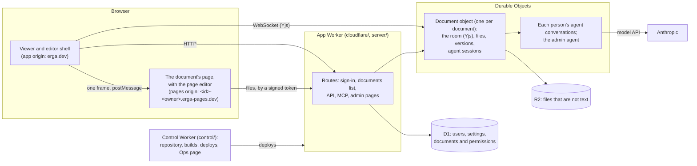

# Erga

Erga is a multiplayer editor for web pages. People and their AI agents
edit an HTML page together, in place, on the rendered page. A document is a
folder of files (HTML, CSS, scripts, images) that shows as one page. You
type into the page as you would into a word processor, and the agent
changes any file when you ask it to. Everyone sees each edit as it happens.

Erga is for people who want more than a text document can show, such as a
design doc with a working prototype, a slide deck or an interactive
explainer, but who want to keep control of their own words.

It runs on Cloudflare. The hosted version is at https://erga.dev.

## Quick start

You need [Bun](https://bun.sh) 1.4 or newer, and Git.

    bun install
    bun start          # the app, locally, in your browser (bun start --help for the rest)
    bun run test       # the format check, lint, typecheck, unit tests and smoke run: under a minute
    bun run format     # formats the lines your change touches (Biome, biome.json), and no others
    bun run test:full  # and every end-to-end test (e2e/full): only when you want the whole suite

`bun start` runs the same Worker that Cloudflare runs, under Vite and
Miniflare, and signs you in without GitHub. To turn on the agent, put an
Anthropic API key in `.dev.vars` (`ANTHROPIC_API_KEY`), or export it in the
shell. `bun start path/to/folder` opens a folder on disk as a document:
edits in the browser go to the files, and edits to the files show in the
browser.

CONTRIBUTING.md tells how to send a change. AGENTS.md has the rules for
coding agents.

## How it works

- **The shell** is the page at `/<owner>/<slug>` on the app's origin. It
  shows the band above the document, the agent's panel and the people who
  are in the document. It holds the document's page in one frame.
- **The page** runs on a separate origin for each document (the pages
  origin). A page is not trusted: it can run any script, so its origin
  holds nothing but its own document. The server gives each page the source
  marks that the editor needs. When you start to edit, the shell loads the
  page editor into the page, and the page editor edits the page in place.
- **The document** is a Durable Object (`cloudflare/document-object.ts`)
  around a `Document` (`document/`) that has no Cloudflare code in it. The
  document keeps its files and versions in the object's storage, and large
  files in R2. Its room is a shared Yjs document: each editor tab joins it
  over a WebSocket, and each agent session joins it in the same process.
- **The agents.** The document agent (`editor-agent/`) edits the files of
  one document for one person, in the same room as the people. The admin
  agent (`agents/admin.ts`) does what an admin does on the admin pages. An
  outside agent uses the same tools with a person's agent token, over the
  HTTP API or MCP (`server/api.ts`).
- **The database** is D1: the users, the server's settings, and each
  document's address, owner and permissions (`server/directory/`).
- **The control Worker** (`control/`) is apart from the app. It holds
  Erga's Git repository, builds each commit in a container, deploys the
  app, checks the app's health and rolls back a bad deploy. A broken app
  cannot stop the way to fix it.

## Self-host on Cloudflare

Erga needs a Cloudflare account on the Workers Paid plan: Workers, Durable
Objects, D1 and R2, and for the control Worker, Containers (for builds) and
Artifacts (for the repository). You need a zone for the app, and a
separate zone for the pages origins, so that a page can never run on the
app's origin.

1. Put your values in `deploy/targets.json`: the account, the admins, the
   hosts and zones, and the ids of your GitHub and Cloudflare OAuth apps.
   You do not change code.
2. Deploy production the first time (`bun deploy/run.ts production`), then
   set up the control Worker and staging (`bun deploy/setup.ts`).
3. Open the control Worker's page, and connect Cloudflare.
4. After that, a push to `staging` deploys staging, and a move of `main`
   deploys production.

docs/self-host.md gives each step. docs/operations.md tells how deploys,
health checks and rollbacks work.

## The layout

    document/     one document, with no Cloudflare in it
      document.ts     class Document: one running document over a Storage (files, room, versions, expiry)
      storage.ts      the Storage a document needs; MemoryStorage for the tests
      host.ts         the document's HTTP API: its routes, the agent sessions, the tabs
      tabs.ts         the document's tabs, over WebSockets that outlive the open document
      content.ts      what a document room holds: files, assets, authors, folders (the shared Yjs doc)
      pages.ts        a document's files as pages, and their addresses
      room.ts         the document room: the shared doc and who is in it
      versions.ts     a document's versions: snapshots to look back at and restore
      blobs.ts        the files that are not text, by their sha-256
      merge.ts        an outside edit, as a small change to the open document
      pdf.ts          PDFs for the agents: their pages and their text
      api.ts          the document API's contract (document/host.ts has its routes)
    server/       the app: web Requests in, Responses out (the unit tests run it under bun)
      app.ts          the one route table, and what every page of the site's own gets
      platform.ts     Platform, what the app needs from where it runs, and Session, who is asking
      api.ts          the HTTP API for outside agents: tokens, /api, /mcp, the guide, /tokens, /settings
      health.ts       the health check, GET /api/health
      security.ts     the security headers on every answer of the app
      live.ts         open pages follow a redeploy
      directory/      the database: documents, owners and permissions (directory.ts), users, sign-in identities,
                      access rules, settings and their change log, the API keys admins store
      identity/       who is asking: sessions (session.ts), agent tokens (tokens.ts), sign-in with GitHub or Google
                      (sign-in.ts, accounts.ts) and its settings (settings.ts, apps.ts), cookies, the staging guard
                      (admins-only.ts), the other of a deployment's servers (peer.ts)
      documents/      the front door for documents: a document's address and access (front-door.ts), the pages origin
                      and its tokens (pages-origin.ts), the viewer (view.ts), new/list/delete/share (make.ts), the
                      front page's document (landing.ts)
      pages/          the HTML the server renders, no routing: the viewer's scripts and styles (viewer.ts), the page's
                      own script (reader.ts), the files view (files.ts), the documents list (docs.ts), the start page,
                      the account menu, the templates, and what every page shares (chrome.ts)
      home/           the homepage: its deploys (deploys.ts), serving / from the snapshot (serve.ts), the page (render.ts), the API
      admin/          the admin pages (pages.ts), the layout and style they share, each admin's agent (agent.ts)
      deploys/        who may use the deploy page (access.ts), the deploys' API (api.ts)
      source/         Erga's own Git repository: its routes (routes.ts), the repository (repo.ts), Git itself (git.ts,
                      http.ts, merge.ts), the GitHub App (github.ts), the Ops page (page.ts)
      migrations/     the database's schema, one file for each change (AGENTS.md, rule 3)
    editor-agent/ the document agent: session.ts (one session per person per document), workspace.ts, PROMPT.md
    agents/       what the agents share, and the admin agent
      tools.ts        the tools both agents and the outside API share; actions.ts, the audit of every action and its tool
      models.ts       the models, their prices, the agent's configuration and the scripted test model
      checkpoint.ts   an agent's conversation, kept step by step (chat-store.ts, in a Durable Object's SQLite)
      admin.ts        the admin agent, with admin-chats.ts
    shared/       code the server and the browser bundles both use: the agent's transcript (agent-log.ts), attached
                  files (attach.ts), who did something (attribution.ts), a page's text and its source (manuscript.ts,
                  page.ts), the room's socket (room-socket.ts), ... The browser's bundles may have shared/, and of
                  document/ only content.ts, pages.ts, merge.ts and api.ts's types: tests/browser-imports.test.ts keeps it so
    client/       the browser side: editor.html, style.css, fonts/, and the scripts build.ts bundles into .build/
                  (main.ts and shell/ the editor's shell, frame.ts, editor.ts and page-editor/ the page editor, collab.ts
                  the room, agent-chat.ts the agent's panel, files.ts, settings.ts, pages-tree.ts, admin-agent.ts, ...)
    cloudflare/   only what runs on Cloudflare: the Worker's entry (index.ts), the Platform from its bindings
                  (platform.ts; env.ts types them), D1 (d1.ts), R2 (blobs.ts), the Durable Objects (document-object.ts and objects/:
                  each gives its logic in server/, agents/ or document/ storage, alarms and sockets, and decides
                  nothing), the dev server's routes (dev.ts, dev-entry.ts), the app's own deploy routes
                  (branch-deploys.ts) and /deploy's (deploy-routes.ts, deploy-session.ts)
    control/      the control Worker: Erga's repository and Git endpoint, the deploy pipeline, the Ops page and its
                  sign-in, and the build container (builder/), apart from the app, so a broken app never takes the
                  way to fix it down (index.ts the entry, routes.ts, platform.ts, wrangler.jsonc: its bindings). The app reaches it
                  over a service binding; locally the app hosts its routes.
    deploy/       the deploy pipeline (pipeline.ts, and control.ts for the control Worker's own deploy), its Cloudflare
                  credential (credential.ts: an OAuth grant), branch deploys (branches.ts), the release build
                  (release.ts) and the release store (releases.ts), installs in other accounts (install.ts, forks.ts),
                  the targets (targets.json), the setup runbook (setup.ts), the settings a deploy locks
                  (locked-settings.ts), and the mock Cloudflare the tests use
    dev/          local development: start.ts (`bun start`), the Vite plugin, live reload, the formatter on changed
                  lines (format.ts, `bun run format`), a Git server and a mock GitHub and Google for tests, and a
                  document's files on disk as its Storage (disk-storage.ts, over the mirror the plugin serves)
    assets/       files the server ships: logo/, landing/ (the first homepage) and templates/ (new documents)
    docs/         self-host.md (deploy your own Erga), operations.md (how a deployment deploys), the screenshot above
    tests/        the unit tests (bun test); e2e/ the end-to-end tests (e2e/smoke, e2e/full) and benchmarks (e2e/bench)

Each area of `server/` (directory, identity, documents, pages, home,
admin, source) is imported through its `index.ts`, its interface. Only
`cloudflare/` and `control/` read the Worker's bindings; `server/` and
`document/` never import them. The configs at the root are the ones their
tools look for there: `cloudflare.config.ts` (the Worker and its bindings),
`vite.config.ts`, `e2e.config.ts`, `tsconfig.json`, `biome.json`.

Building: `bun run build` (client/build.ts) writes the client's files to
`.build/`; `bun run release` (deploy/release.ts) adds the Worker's release to
`.build/release/`. The builder container runs both in each commit it deploys.

## License

MIT (LICENSE). The fonts and packages that Erga ships have their own
licenses: THIRD_PARTY_NOTICES.md lists them.
