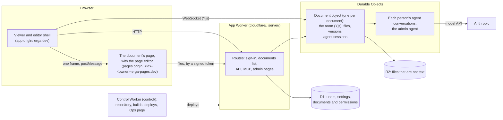

# Erga

Erga is a multiplayer editor for web pages. People and their AI agents
edit an HTML page together, in place, on the rendered page. A document is a
folder of files (HTML, CSS, scripts, images) that shows as one page. You
type into the page as you would into a word processor, and the agent
changes any file when you ask it to. Everyone sees each edit as it happens.

Erga is for people who want more than a text document can show, such as a
design doc with a working prototype, a slide deck or an interactive
explainer, but who want to keep control of their own words.

It runs on Cloudflare. The hosted version is at https://erga.dev.

## Quick start

You need [Bun](https://bun.sh) 1.4 or newer, and Git.

    bun install
    bun start          # the app, locally, in your browser (bun start --help for the rest)
    bun run test       # the format check, lint, typecheck, unit tests and smoke run: under a minute
    bun run format     # formats the lines your change touches (Biome, biome.json), and no others
    bun run test:full  # and every end-to-end test (e2e/full): only when you want the whole suite
    bun run look Enter # presses keys in the editor, headless: prints the page as text, saves a screenshot

`bun start` runs the same Worker that Cloudflare runs, under Vite and
Miniflare, and signs you in without GitHub. To turn on the agent, put an
Anthropic API key in `.dev.vars` (`ANTHROPIC_API_KEY`), or export it in the
shell. `bun start path/to/folder` opens a folder on disk as a document:
edits in the browser go to the files, and edits to the files show in the
browser.

`ERGA_DEV_LATENCY_MS=120 bun start` (or a range, `60-180`) delays each message
between a tab and the room by that much, each way, as a deployed Worker's
network does. `bun run look --latency 120` and the e2e helper
`startServer({ latency })` set it too. It is for the dev server only.

CONTRIBUTING.md tells how to send a change. AGENTS.md has the rules for
coding agents.

## How it works

- **The shell** is the page at `/<owner>/<slug>` on the app's origin. It
  shows the band above the document, the agent's panel and the people who
  are in the document. It holds the document's page in one frame.
- **The page** runs on a separate origin for each document (the pages
  origin). A page is not trusted: it can run any script, so its origin
  holds nothing but its own document. The server gives each page the source
  marks that the editor needs. When you start to edit, the shell loads the
  page editor into the page, and the page editor edits the page in place.
- **The document** is a Durable Object (`cloudflare/objects/document.ts`)
  around a `Document` (`document/`) that has no Cloudflare code in it. The
  document keeps its files and versions in the object's storage, and large
  files in R2. Its room is a shared Yjs document: each editor tab joins it
  over a WebSocket, and each agent session joins it in the same process.
- **The agents.** Each person has one agent (`agents/person/`), on every
  page: it does what they can, and edits a document's files in its room as
  they would (`agents/document/`: one session per person per document, where
  every agent's document tools run). An outside agent uses the same tools with
  a person's agent token, over the HTTP API or MCP (`server/api.ts`).
- **The database** is D1: the users, the server's settings, and each
  document's address, owner and permissions (`server/directory/`).
- **The control Worker** (`control/`) is apart from the app. It holds
  Erga's Git repository, builds each commit in a container, deploys the
  app, checks the app's health and rolls back a bad deploy. A broken app
  cannot stop the way to fix it.

## Self-host on Cloudflare

Erga needs a Cloudflare account on the Workers Paid plan: Workers, Durable
Objects, D1 and R2, and for the control Worker, Containers (for builds) and
Artifacts (for the repository). You need a zone for the app, and a
separate zone for the pages origins, so that a page can never run on the
app's origin.

1. Put your values in `deploy/targets.json`: the account, the admins, the
   hosts and zones, and the ids of your GitHub and Cloudflare OAuth apps.
   You do not change code.
2. Deploy production the first time (`bun deploy/run.ts production`), then
   set up the control Worker and staging (`bun deploy/setup.ts`).
3. Open the control Worker's page, and connect Cloudflare.
4. After that, a push to `staging` deploys staging, and a move of `main`
   deploys production.

docs/self-host.md gives each step. docs/operations.md tells how deploys,
health checks and rollbacks work.

## The layout

    document/     one document, with no Cloudflare, server or agent code in it (it gets them through DocumentDeps)
      document.ts     class Document: one running document over a Storage (files, room, versions, expiry)
      access.ts       who may do what: the document's copy of its permissions, and the requests it decides with them
      view.ts         what viewers see: the files as they are now, under a version that is their digest
      names.ts        a document's name: its title and address (/<owner>/<slug>), and renames
      agent.ts        what the document needs of its agents (agents/document/ fulfils it)
      storage.ts      the Storage a document needs; MemoryStorage for the tests
      host.ts         the document's HTTP API: its routes, each person's agent session, the tabs
      snapshot.ts     a document's storage as one value: the export, the import and their endpoints
      tabs.ts         the document's tabs, over WebSockets that outlive the open document
      content.ts      what a document room holds: files, assets, authors, folders (the shared Yjs doc)
      pages.ts        a document's files as pages, and their addresses
      room.ts         the document room: the shared doc and who is in it
      versions.ts     a document's versions: snapshots to look back at and restore
      blobs.ts        the files that are not text, by their sha-256
      merge.ts        an outside edit, as a small change to the open document
      pdf.ts          PDFs for the agents: their pages and their text
      page-api.ts     a page's own API: its module, run in a sandbox for the agents (shared/page-ops.ts checks its answer)
      disk.ts         local development: a document's files in a folder on disk, through the dev server
      api.ts          the document API's contract (document/host.ts has its routes)
    server/       the app: web Requests in, Responses out (the unit tests run it under bun)
      app.ts          the one route table, and what every page of the site's own gets
      platform.ts     Platform, what the app needs from where it runs, and Session, who is asking
      http.ts         the routes' HTTP in Effect (effect/http): a route is an Effect, the Platform a service, the answers they share
      api.ts          the HTTP API: /api/tools (the operations, for the pages and every agent), tokens, /mcp, and /llms.txt (a pointer to /mcp)
                      (the tools: agents/tools.ts)
      health.ts       the health check, GET /api/health
      security.ts     the security headers on every answer of the app
      live.ts         open pages follow a redeploy
      news/           live pages: which rows changed, for the open pages that show them (hub.ts, its Durable Object
                      cloudflare/objects/news.ts), and the rows a page asks for then (routes.ts)
      directory/      the database: documents, owners and permissions (directory.ts), users, sign-in identities,
                      access rules, settings and their change log, the API keys admins store
      identity/       who is asking: sessions (session.ts), agent tokens (tokens.ts) and their page (tokens-page.ts:
                      /tokens, /settings), MCP's sign-in for agents' apps (oauth.ts), sign-in with GitHub or Google (sign-in.ts, accounts.ts) and its settings
                      (settings.ts, apps.ts), cookies, the staging guard (admins-only.ts)
      documents/      the app for documents: a document's address and access (routes.ts), the pages origin
                      and its tokens (pages-origin.ts), the viewer (view.ts), new documents and the list (make.ts),
                      the homepage's document (landing.ts)
      pages/          the HTML the server renders, no routing: the viewer's scripts and styles (viewer.ts), the page's
                      own script (reader.ts), the documents list (docs.ts), the start page,
                      the account menu, the templates, and what every page shares (chrome.ts)
      home/           the homepage: its deploys (deploys.ts), serving / from the snapshot (serve.ts), the page (render.ts), the API
      admin/          the admin pages, one file for each (settings.ts, api-keys.ts, auth.ts, access.ts, changes.ts,
                      users.ts), their routes (routes.ts) and the layout they share
      operations/     each thing a person does on the server, defined once (operation.ts): documents, sharing and
                      tokens (documents.ts), the admin pages' settings, keys, sign-in, users and rules (admin.ts).
                      The pages call them over POST /api/tools/<name>; every agent has them as tools
      migrations/     the database's schema, one file for each change (AGENTS.md, rule 3)
    agents/       each person's agent and the tools
      run.ts          the agent loop, on Effect AI: the model, the transcript, the checkpoints
      tools.ts        the one tool set: the server's operations and the document tools for any document, for every
                      agent as its person (a document token never with admin power); actions.ts, the audit of
                      every action and its tool
      models.ts       the models (Effect AI's Anthropic provider), the agent's configuration and the scripted test model
      checkpoint.ts   an agent's conversation, kept step by step (chat-store.ts, in a Durable Object's SQLite)
      document/       every agent's hands in a document: session.ts (one session per person per document, where the
                      document tools run), workspace.ts, tools.ts, prompt.ts and PROMPT.md (what a prompt says of documents)
      person/         each person's agent: agent.ts (its session), prompt.ts, sessions.ts (one session per person, in
                      their object, and its routes), panel.ts (the panel's preferences)
    shared/       code the server and the browser bundles both use: the agent's transcript (agent-log.ts), attached
                  files (attach.ts), who did something (attribution.ts), a page's text and its source (manuscript.ts,
                  page-html.ts), the room's socket (room-socket.ts), ... The browser's bundles may have shared/, and of
                  document/ only content.ts, pages.ts, merge.ts and api.ts's types: tests/browser-imports.test.ts keeps it so
    libs/         Erga's editing libraries, apart from Erga's code: each has an api/ (named edits on the page's HTML, with
                  no browser: the layer of shared/) and a ui/ (keys, carets, the drawing: the browser's layer). The API never
                  imports the UI
      text/           erga/text, the page editor in the page (frame.js: ui/frame.ts, with its own socket and replica of the
                      room, ui/collab.ts, opened with the edit key the shell gives it; its own controls, ui/controls.ts,
                      and uploads, ui/uploads.ts): api/ has the editing rules (rules.ts,
                      blocks.ts, lists.ts), styles and links (format.ts), the source's helpers (source.ts), the clipboard's
                      blocks, and erga/text's API (edits.ts: the named edits agents run with call_edit)
      slides/         erga/slides, a deck's library (slides.js, which the page imports: ui/slides.ts shows one 16:9
                      slide at a time with the page's steps, and in the editor loads erga/text and the slide bar,
                      ui/bar.ts): api/slides.ts has the slide edits (add, delete, move, layout) over erga/text's
      canvas/         erga/canvas, a canvas presentation's library (canvas.js: ui/canvas.ts moves a camera over the
                      page's frames, its steps and its zoom, and in the editor loads erga/text). No edits of its own
    client/       the browser side: editor.html, style.css, fonts/, and the scripts build.ts bundles into .build/
      shell/          the editor's shell (page.js): main.ts, its one word to the page's editor (page-frame.ts: edit, with the
                      edit key, or view), its replica of the room (libs/text/ui/collab.ts), the source view, the shell's parts
      page-tools/     Erga's page tools in the document's page (tools.js: tools.ts): the agent's view_page and
                      eval_in_page (a fresh render, capture.ts) and the live page's tools (live-page-tab.ts), apart from
                      the editing libraries; the page's first script loads them when the viewer first asks
      agent/          the agent panel both the editor and the admin pages use (agent-chat.ts, layout.ts, ...)
      admin/          the admin pages' scripts (admin-agent.ts, admin-nav.ts, admin-share.ts)
      pages/          the other pages' scripts: the settings, the pages tree
      live/           open pages across a redeploy (live.ts, client.ts, restore.ts)
      inline/         the scripts and styles a page carries inline, typed (build.ts --inline writes
                      server/pages/inline-code.ts): the documents list, the Ops, install and admin pages, ...
      common/         what the inline scripts and the bundles share: fast-click.ts, new-doc.ts, bars.ts, quick.ts, ...
      styles/         admin.css and ops.css, which the build writes as the admin pages' one stylesheet
    cloudflare/   only what runs on Cloudflare: the Worker's entry (index.ts), the Platform from its bindings
                  (platform.ts; env.ts types them), D1 (d1.ts), R2 (blobs.ts), the sandbox for pages' own APIs (sandbox.ts), the app's Durable Objects (objects/:
                  each gives its logic in server/, agents/ or document/ storage, alarms and sockets, and decides
                  nothing), what the deploy pipeline asks of the app (deploy-routes.ts), the dev server's routes
                  (dev.ts, dev-entry.ts)
    control/      the control Worker: Erga's repository and Git endpoint, the deploy pipeline, the Ops page and its
                  sign-in, and the build container (builder/), apart from the app, so a broken app never takes the
                  way to fix it down (index.ts the entry, settings.ts its settings, routes.ts, operations.ts: the Ops page's operations, which the app's
                  /api/tools and every admin's agent have too, platform.ts, wrangler.jsonc: its bindings, env.ts types them; d1.ts). The app reaches it
                  over a service binding; locally the app hosts its routes.
      source/         Erga's own Git repository: its routes (routes.ts), the repository (repo.ts) and its Durable
                      Object (source-host.ts), Git itself (git.ts, http.ts, merge.ts), the GitHub App (github.ts),
                      the Ops page (page.ts) and its operations on the repository (operations.ts)
      deploys/        the deploy pipeline (pipeline.ts; control-worker.ts for the control Worker's own deploy), its
                      Cloudflare credential (credential.ts: an OAuth grant), branch deploys (branches.ts, in
                      pipeline-object.ts), the release store (releases.ts), the Ops page's operations on the deploys (operations.ts), the event stream (api.ts)
      install/        /deploy: installs in other accounts (install.ts, forks.ts, the page, its routes and session)
      cloudflare.ts   what the control Worker has of Cloudflare: Artifacts, the GitHub App, the release bucket
    deploy/       what a person runs on a machine: a deploy (run.ts), the release build (release.ts), the setup
                  runbook (setup.ts), the first push of Erga's history (import-source.ts), the targets (targets.json,
                  targets.ts), the settings a deploy locks (locked-settings.ts)
    dev/          local development: start.ts (`bun start`), the Vite plugin, live reload, the formatter on changed
                  lines (format.ts, `bun run format`), a Git server, a mock GitHub, Google and Cloudflare
                  (mock-cloudflare.ts) for tests, and the folders on disk that documents link to (the plugin)
    assets/       files the server ships: logo/, landing/ (the first homepage) and templates/ (new documents)
    docs/         self-host.md (deploy your own Erga), operations.md (how a deployment deploys), the screenshot above
    tests/        the unit tests (bun test, no browser), their helpers in tests/helpers/; e2e/ the browser tests
                  (e2e/smoke, e2e/full), benchmarks (e2e/bench) and their helpers (e2e/helpers/)
    .github/      the tests on each pull request and push (workflows/test.yml)

The folders are layers. A file imports only its own layer and the layers
below it, lowest first: `shared/` (and each library's `api/`), `document/`, the areas of `server/`,
`control/`, `agents/`, `server/app.ts` and `server/api.ts`, `cloudflare/`.
`client/` and each library's `ui/` import `shared/`, `libs/` and a few files of `document/`; `deploy/`,
`dev/`, `tests/` and `e2e/` import anything. Each area of `server/`
(directory, identity, documents, pages, home, admin, operations) is imported through
its `index.ts`, its interface. Only `cloudflare/` and `control/` read the
Workers' bindings, and `control/` never imports `cloudflare/`. `tests/imports.test.ts` has the whole rules and checks
them.

The configs at the root are the ones their tools look for there:
`cloudflare.config.ts` (the Worker and its bindings), `vite.config.ts`,
`e2e.config.ts`, `biome.json`, and the typecheck's three projects:
`tsconfig.json` (what runs under Bun: deploy/, dev/, tests/, e2e/),
`tsconfig.workers.json` (the Workers) and `tsconfig.browser.json` (the
browser).

Building: `bun run build` (client/build.ts) writes the client's files to
`.build/`; `bun run release` (deploy/release.ts) adds the Worker's release to
`.build/release/`. The builder container runs both in each commit it deploys.

## License

MIT (LICENSE). The fonts and packages that Erga ships have their own
licenses: THIRD_PARTY_NOTICES.md lists them.
