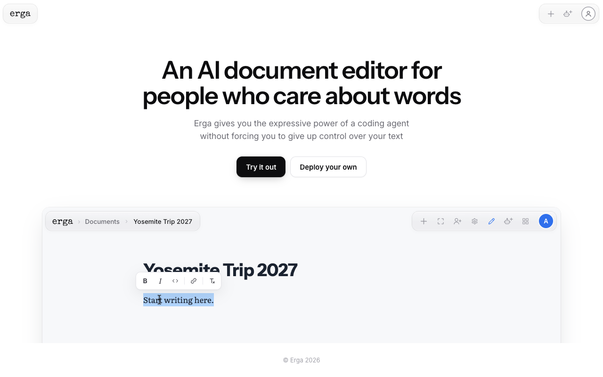
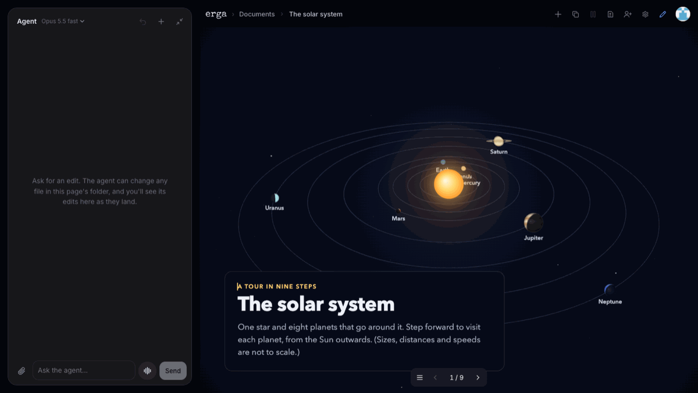

# Erga

**An AI document editor for people who care about words.**

Erga gives you the expressive power of a coding agent without forcing you to
give up control over your text.

Write it with your agents: ask an agent for a change in plain words, and
watch it land in the text, where you can still edit it by hand. A document
is a real web page, so it can be a design doc with a working prototype, a
slide deck or an interactive explainer. Everyone in it sees each edit as it
happens.

Try it at [erga.dev](https://erga.dev).

## Setup

Run your own Erga on your own domain, in your Cloudflare account (the
Workers Paid plan) or your AWS account (the domain in Route 53). You also
need a GitHub account, Bun and git. Give your coding agent this prompt, in
any folder:

> Set up my own Erga. Follow https://github.com/koomen/erga#setup.

### For the agent

1. Get the code: `git clone https://github.com/koomen/erga && cd erga && bun install`.
2. Ask the person these questions, one at a time, in these words. Ask only
   these, and decide nothing for them.
   1. "On which address should Erga run? For example erga.example.com. It
      must be on a domain you own, and nothing may use it yet."
   2. "Where should Erga run? 1. Cloudflare (recommended): the Workers Paid
      plan, $5 a month. 2. AWS: in your own AWS account. AWS bills by use."
      On AWS, ask which AWS profile (`aws configure list-profiles`), if there
      are several.
   3. Cloudflare only: "Do you also want a staging server? It is a second
      server, for trying updates before production, with a copy of
      production's data, for admins only. Answer no, or its address, for
      example staging.example.com."
   4. "Who may sign in? 1. Only people you invite (recommended) 2. Anyone in
      your company 3. Your company's single sign-on"
      - 2: "Which GitHub organization or email domain? For example acme-inc
        or acme.com."
      - 3 on Cloudflare: "What is your Cloudflare Zero Trust team name? It is
        the part before .cloudflareaccess.com." Then: "In Zero Trust, add a
        self-hosted application for the address (and staging's), with a
        Bypass policy for the paths that need no sign-in. Then give me its
        Application Audience (AUD) tag."
      - 3 on AWS: "What is the issuer URL of your company's sign-in (OpenID
        Connect)?" and "What is Erga's client ID there? Its callback is
        https://<address>/oauth2/idpresponse." The person types the client's
        secret later, on a page that opens: never ask for it.
      - 1 or 2 on AWS: "Which second Route 53 domain should hold the
        documents' pages? Not the domain of the address."
3. Run the dry run, with each answer as an option. It checks the answers,
   opens the Cloudflare or AWS sign-in if needed, prints the plan, and makes
   nothing:

       bun erga setup <address> --host cloudflare|aws --sign-in invite|company|sso \
         [--staging <address>] [--profile <name>] [--company <org or domain>] \
         [--team <name> --aud <tag>] [--issuer <URL> --client <ID>] [--pages <domain>] --dry-run

4. Tell the person the plan, and ask: "Shall I make it?" On yes, run the same
   command without `--dry-run`. It runs to the end, and opens the browser
   for the person's own steps: the GitHub App (one click), and a one-time
   link that makes them the admin. Tell the person what each WAIT line says.

Run the command with a timeout of 10 minutes. It ends with one line:

- DRY RUN: the plan. Ask for the yes.
- DONE: tell the person what the line says.
- WAIT: the person's step is still open, or the build takes longer. Run the
  same command again: it goes on from where it stopped.
- FAIL: it says what is wrong, and what to do. When it names an option (two
  Cloudflare accounts hold the domain: `--account`), ask the person, and run
  it again with that option. Never guess past it.

The rules: you make nothing yourself (no resource, no file, no token). A
secret never goes into the chat, a command or a file: the person types it
in the browser, and only there. You never open, read or repeat a link that
the command opens. `bun erga setup <address> remove --yes` deletes a
server with all its documents: only when the person asks for it, in those
words. Bun installs into `~/.bun/bin`, which a new shell may not have on
its PATH. `bun erga setup --help` lists every option.

Later deploys run on your machine, from your clone: `git pull`, then
`bun erga deploy <commit> <host>`.

## Develop

`bun erga skill` tells how to work in this repository: a feature branch for
each change, the tests, and how a change reaches staging and production.
`bun erga --help` lists the commands. The code is the source of truth.

## License

MIT (LICENSE). THIRD_PARTY_NOTICES.md lists the code of others that Erga
ships. SECURITY.md tells how to report a vulnerability.
